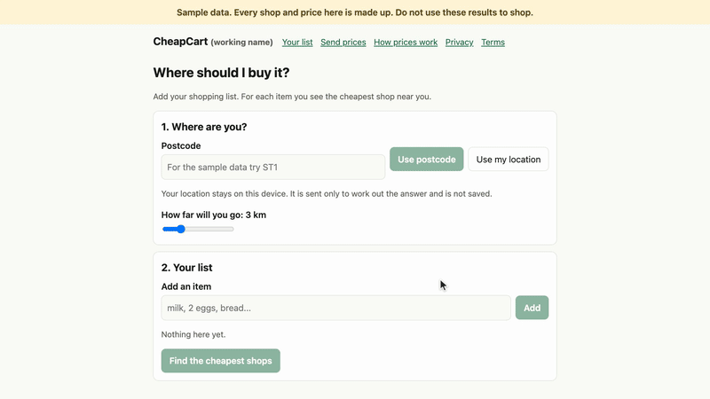

# CheapCart (working name)

You type a shopping list. For every item, CheapCart tells you which shop near you sells it cheapest, what the whole list costs, and how that compares with just going to one shop.

It is a small web app (Next.js and TypeScript) with no accounts and no tracking. Your location is used for one calculation and never stored.



The recording is of the real app running on made-up sample data. More on the [project page](https://abozaralizadeh.github.io/CheapCart/).

## Status

Early. It works end to end, but only on **made-up sample data**. There are no real shops or prices in it, every price on screen carries a "sample" tag, and a banner says the data is made up. Nothing here is a finished product you can point at a real town yet. The roadmap is in [docs/ROADMAP.md](docs/ROADMAP.md).

There is no scraping of any shop, on purpose. Prices come from CSV files you load, and later from prices people send in.

## Quick install

You need Node.js 20.9 or newer.

```bash
git clone https://github.com/abozaralizadeh/CheapCart.git
cd CheapCart
npm install
npm run dev
```

Open http://localhost:3000. Type `ST1` as the postcode, add a few items (milk, 2 eggs, bread) and press the button. `ST1` to `ST6` and `SV1` to `SV3` are made-up postcodes. The sample data is created for you the first time you run the app.

## Run the tests

```bash
npm test
npm run typecheck
```

## Run it on a server

On a Debian or Ubuntu machine, `sudo ./setup_service.sh` installs what's needed, builds the app, creates a `cheapcart.service` systemd service plus a daily price check and a daily backup, and starts it. Run it again any time to update and restart. Logs: `journalctl -u cheapcart.service -f`. The script has only been syntax checked so far, not run on a real server, so expect to fix a rough edge or two. See [docs/OPERATIONS.md](docs/OPERATIONS.md).

## What's in it

| Part | What it does |
| --- | --- |
| List page | Type items with suggestions, set a postcode or device location and a distance, see the cheapest shop for each item, the total, and the best single shop next to it |
| By item and by shop views | The same answer two ways. The shop view has tick boxes for use in the shop and a map link |
| Send prices (`/submit`) | Paste a text receipt, check every line, send. Odd prices wait for a person |
| How prices work, Privacy, Terms | Plain pages. Privacy and Terms are drafts and are not legal advice. Have them checked before you use them anywhere real |
| Commands | Import prices and catalog, freshness, quality and unmatched reports, review queue |

## What is faked

Anything that needs a paid or outside service sits behind an interface with a local stand-in:

| Real thing | Interface | Stand-in now |
| --- | --- | --- |
| AI that reads receipt photos | `ReceiptReader` in `src/lib/receipts.ts` | `FakeReceiptReader`. It reads plain text receipts only. Photos get a clear "not connected yet" answer |
| Real shop prices | `PriceSource` in `src/lib/sources.ts` | CSV files, and made-up sample data |
| Database | Files in `data/` read by `src/lib/store.ts` | Plain CSV files. PostgreSQL is the plan for when files stop being enough, see [docs/DESIGN.md](docs/DESIGN.md) |

## Commands

| Command | What it does |
| --- | --- |
| `npm run sample:generate` | Rewrites the made-up sample data with today's dates |
| `npm run import:prices -- <file.csv>` | Checks and adds prices. Bad rows are reported, big jumps are held back in `flagged.csv`, add `--accept-flagged` after checking them |
| `npm run import:catalog -- <file.csv> --kind shops` | Adds or updates `shops`, `items`, `aliases` or `products` |
| `npm run report:freshness` | How many prices are fresh, near the limit or stale. Exits with 2 when most are unusable |
| `npm run report:quality` | Per area: item coverage, shops, price age, and whether the area is ready |
| `npm run report:unmatched` | The most common list lines we could not match. Removes entries older than 90 days |
| `npm run review -- list` | Prices waiting for a person. Also `approve <id> [--product <id>]`, `reject <id>` and `reports` |
| `scripts/backup.sh` | Writes a dated archive of the data, runtime and config folders and keeps the newest 14 |
| `scripts/restore.sh <archive>` | Puts an archive back. The old folders are kept beside it |
| `npx tsx scripts/loadtest.ts [url] [seconds] [users]` | Sends compare requests from virtual users and prints timings. Use on your own copy only |

## Settings

Everything is in environment variables, listed with their defaults in [.env.example](.env.example): 3 km distance (1 to 10), a 14-day price limit and so on. Areas and postcodes are in [config/areas.json](config/areas.json). Set `LAUNCH_AREAS` to switch areas on or off. Point `DATA_DIR` at a folder like `data/live` for real data.

## Logs

The app writes JSON lines to `logs/app.log`, rotated at 1 MB and keeping 3 files. It logs counts and errors only, never a list or a location.

## Where to read

| File | What's in it |
| --- | --- |
| [docs/ROADMAP.md](docs/ROADMAP.md) | What's built, what isn't, and where help is useful |
| [docs/LOGICAL-FLOW.md](docs/LOGICAL-FLOW.md) | The main flows, step by step |
| [docs/DESIGN.md](docs/DESIGN.md) | Architecture, data model, screens and key decisions |
| [docs/OPERATIONS.md](docs/OPERATIONS.md) | Weekly and monthly jobs, restoring a backup, shop complaints |

## Contributing

Issues and pull requests are welcome. See [CONTRIBUTING.md](CONTRIBUTING.md), including the short note on the licence of contributions. Please run `npm test` and `npm run typecheck` before you send a change, and add a test for new logic. Keep the rules in [docs/DESIGN.md](docs/DESIGN.md) in mind: rank by price per unit only, always show how old a price is, never hide an item that couldn't be priced, never store or log a location, and don't add anything that scrapes a shop's website or app.

## License

Source available, free for non-commercial use, under the [PolyForm Noncommercial License 1.0.0](LICENSE). You can read it, run it, change it and share it for non-commercial purposes. Commercial use needs written permission: ask by opening a GitHub issue. This is not an open source licence, because open source licences allow commercial use.

The docs in `docs/` and the images in `site/img` are under [CC BY-NC 4.0](https://creativecommons.org/licenses/by-nc/4.0/). The npm packages the app uses are installed from npm and keep their own licences. Nothing from outside is bundled in this repository.
