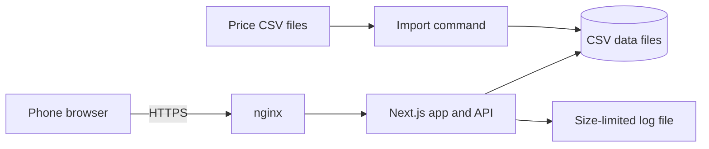
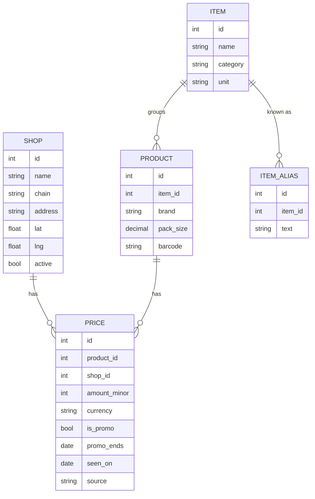

# Design

This describes what is built now, and says where it differs from the first idea. Choices marked Proposed are defaults that can change. The phases and what is still open are in [ROADMAP.md](ROADMAP.md).

## Architecture

One web app on one Linux VM, with its data in files.

Phase 2 is built with one piece swapped for a stand-in: the API passes an uploaded receipt to a `ReceiptReader`. The built-in reader only understands plain text. A real AI vision provider plugs in behind the same interface. Whoever runs the service needs to pick one and sign a contract first.

## Tech stack

| Part | Choice |
| --- | --- |
| App and API | Next.js with TypeScript |
| Data | CSV files in `DATA_DIR`, read by one module (`src/lib/store.ts`). PostgreSQL is still the plan when files stop being enough |
| Web server | nginx with Let's Encrypt |
| Hosting | One Linux VM, in the same region as users |
| Running it | systemd service `cheapcart.service`, installed and updated by `setup_service.sh` |
| Logs | journald, plus a rotating file with a size limit that can be copied locally |
| Backups | Daily archive of the data, runtime and config folders by `scripts/backup.sh`, newest 14 kept, restored with `scripts/restore.sh`. Copying archives off the VM is still a manual step |
| Tests | Vitest for the logic and for every request handler. No browser test suite yet, the main flow was checked by hand in a browser |

## Data model

The tables below are CSV files today (`shops.csv`, `items.csv`, `aliases.csv`, `products.csv`, `prices.csv`), and ids are short text like `s01` and `p0001`. Sent-in prices go to `user-prices.csv` in the runtime folder. The same shape moves to a database without changes.

Notes:

- **Item** is what you ask for, like "Milk, about 1 L". It has a narrow size band (about 15% around the usual pack) so a single bottle isn't compared with a six-pack. Bigger packs can exist in the data. They are left out of the answer. A wide band can make the saving come out negative, so keep bands narrow. A test on the sample data watches for this.
- **Product** is what's on the shelf, with a brand and a pack size. Any product in an item counts, so the default is "any brand".
- **Price** is never overwritten. A new price is a new row, which keeps history and shows how fast prices change.
- **Money** is stored as whole minor units (cents) to avoid rounding errors.
- **Unit price** is worked out from amount and pack size. It isn't stored.
- **Unmatched text** goes to `unmatched.csv` in the runtime folder with the date and the text (shortened), and no location. Rows older than 90 days are removed when the report runs.
- **Review queue** (`review-queue.json`) holds sent-in prices that need a person. **Reports** (`reports.csv`) hold "price looks wrong" notes.
- There are no user tables in the first version. The list and location stay on the device.

## Screens

The app is built for a phone first. It has one main path.

| Screen | What it does |
| --- | --- |
| List | Type items, set quantities, see suggestions, press compare |
| Location | Enter a postcode or use device location, set the distance |
| Results by item | Each item with its cheapest shop, price, distance and price age. Items with no answer are shown here too |
| Results by shop | The same results grouped by shop, with tick boxes for use in the shop and a link out to a maps app |
| Send prices (`/submit`) | Paste a text receipt or pick a file, check each line, pick the product, send. Lines with personal details are dropped on reading |
| Summary (top of results) | Total to pay, best single shop, and the saving |
| How prices work | Where prices come from, how old they can be, how ranking works |
| Legal pages | Privacy policy, terms, and legal notice if needed |

## API

| Call | What it does |
| --- | --- |
| `GET /api/config` | Areas, default distance and limits for the page |
| `GET /api/items?q=` | Item suggestions as you type |
| `POST /api/area` | Takes a postcode or device location, checks it's covered, and returns the point to use (device locations are rounded to about 100 m). It's a POST so location never lands in a URL or a log |
| `POST /api/compare` | Takes the list, location and distance. Returns results, totals and the saving |
| `POST /api/submissions/read` | Reads a receipt (text or file) in memory and returns lines matched to products. Saves nothing |
| `POST /api/submissions/confirm` | Checks the confirmed lines. Clear ones go live, odd ones wait for a person |
| `POST /api/report` | "Price looks wrong" note |
| `GET /api/health` | For an uptime check. Says whether prices are stale |

Each POST has a rate limit. Sending prices and reports have a stricter one. JSON bodies are capped at 100 KB and uploads at 2.5 MB (a 413 comes back above that), and every response carries `X-Content-Type-Options`, `X-Frame-Options`, `Referrer-Policy` and `Permissions-Policy` headers. There is no Content-Security-Policy yet.

## Commands

These are for running the project and have no screens.

| Command | What it does |
| --- | --- |
| `npm run import:prices -- <file>` | Checks and loads a price CSV. Big jumps go to `flagged.csv` until a person accepts them |
| `npm run import:catalog -- <file> --kind shops` | Loads shops, items, aliases or products |
| `npm run report:freshness` | Lists prices near or past the limit. Exits non-zero when most are unusable |
| `npm run report:quality` | Per area data quality and whether the area is ready |
| `npm run report:unmatched` | Lists the most common unmatched lines |
| `npm run review -- list` | Shows prices waiting for a person. Also `approve`, `reject` and `reports` |
| `npm run sample:generate` | Rewrites the made-up sample data |

## Extension points

- `ReceiptReader` (`src/lib/receipts.ts`): reads a receipt and returns lines. Built-in: plain text only.
- `PriceSource` (`src/lib/sources.ts`): where price rows come from. Built-in: CSV file. An open data feed or a licensed feed is one more class, after a legal check. There is no scraper.
- Areas live in `config/areas.json`, so a new area is a config change plus data.

## Key decisions

Each is Proposed, with the reason.

| # | Decision | Reason |
| --- | --- | --- |
| 1 | Web app first, no native app | Works on any phone straight away, one codebase, no app store review. Good enough for typing a list |
| 2 | Hand-collected prices first | It works in any area, it's the cleanest legal route, and it also tests how fast prices change. It doesn't scale, which is why Phase 2 exists |
| 3 | No scraping without a legal check | Shop terms and database rights can make it risky, and a block could cut off the data overnight. Some countries may publish price data openly, so that gets checked per country in Phase 3 |
| 4 | One small area to start | Grocery data is only useful if it's dense. Good data in one area beats thin data everywhere |
| 5 | Compare by unit price, within a size band | Pack sizes differ, so the shelf price alone is misleading. The band stops a bulk pack winning when you wanted one bottle |
| 6 | "Any brand" as the default | It's the simplest way to give an answer and the biggest source of saving. Choosing a brand can come later if users ask for it |
| 7 | Show best single shop next to the per-item answer | It answers "is it worth the extra stops?" without building route planning. You see the numbers and decide |
| 8 | Work out the saving only on items both sides cover | Otherwise a shop looks cheap just because it's missing items. It keeps the claim honest |
| 9 | Prices expire after 14 days | A wrong price costs trust quickly. Better to show nothing than something stale. The limit can change after Phase 0 shows how fast prices move |
| 10 | Always show price age | People can judge for themselves, and it's honest about hand-collected data |
| 11 | Rank by price only, then distance | The whole product rests on trust. It also keeps the ranking simple to explain, which comparison rules may ask for |
| 12 | Straight-line distance | Cheap, needs no map provider, and is good enough for choosing between nearby shops. Walking or driving time can come later |
| 13 | No accounts in the first version | Less personal data, less legal work, and nothing stops someone trying it. Accounts only come back if a feature needs them |
| 14 | Keep location on the device, don't store it on the server | Location is sensitive. It's only needed for one calculation |
| 15 | Postcode list held locally, link out to a maps app | No third party gets user locations, no map costs, and no extra processor to cover in the privacy policy |
| 16 | One language (TypeScript), one VM, CSV files first | Least to run and maintain, and easy to read and fix by hand while the data is small. Distance is worked out in code with this few shops. Move to PostgreSQL (and PostGIS) when the shop count or the write rate grows |
| 17 | Keep price history | Spotting odd prices needs it, and it makes the data more useful later |
| 18 | AI reads receipts in Phase 2, and the user confirms. A person decides on odd prices | Receipts differ too much for fixed rules, and a model can be wrong, so a person checks. Photos are deleted after reading because receipts can hold personal details |
| 19 | Receipt reading sits behind an interface, with a plain-text stand-in | A real vision provider costs money, needs a contract and a data processing agreement, and the operator has to choose it. The rest of the flow can be built and tested without it |
| 20 | Odd prices wait for a person, no automatic "second source" | With no accounts, two matching sends could come from one person, so agreement proves nothing. A person is the safe check for now |
| 21 | Moderation is a command, not a web screen | A public admin page is more to secure. One person on the VM can run `npm run review` |
| 22 | Sent-in dates may be one day ahead of the server date | The server counts in UTC. Without slack, a shopper ahead of UTC would see "in the future" for today's receipt |

## Privacy and security

- Precise location isn't stored or logged. The logs must leave out request bodies.
- The app sets no tracking cookies and uses no third-party analytics in the first version.
- Basic rate limiting protects the API.
- Unmatched text is kept for 90 days, and people could type something personal in a list line, so it's reviewed and never shown publicly.
- The CSV import runs on the VM only. There's no admin screen on the public web.

## Known weak spots

- Hand-collected prices go stale fast, and promotions make it worse.
- Files are not a database. There's no locking, so two imports at once could clash. Fine for one person running commands, not for heavy write traffic.
- The rate limiter lives in memory, so a restart clears it and it only covers one server.
- Item matching will miss things. The alias table and the unmatched report are the way to improve it.
- Loyalty card prices aren't handled. A shop's cheapest price may need a card. Phase 0 should show how much this matters.
- Request size is checked from the `Content-Length` header and by reading JSON up to a cap. A chunked upload with no length is only stopped by the 2 MB check after it has been read. nginx sets `client_max_body_size 3m` in front of it.
- Availability is unknown. A cheap item may be out of stock when you get there.
