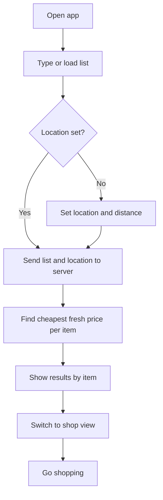
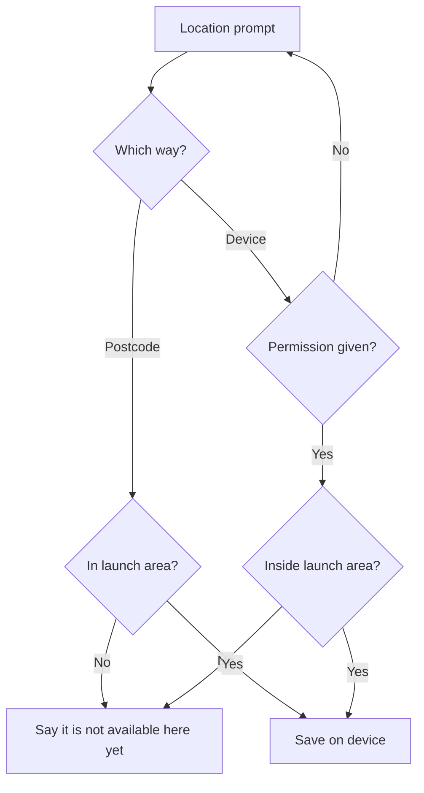
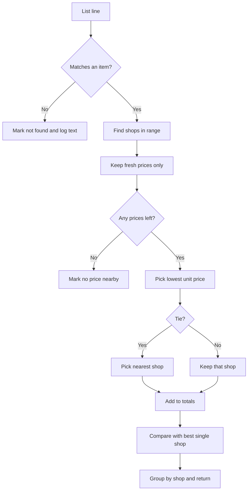
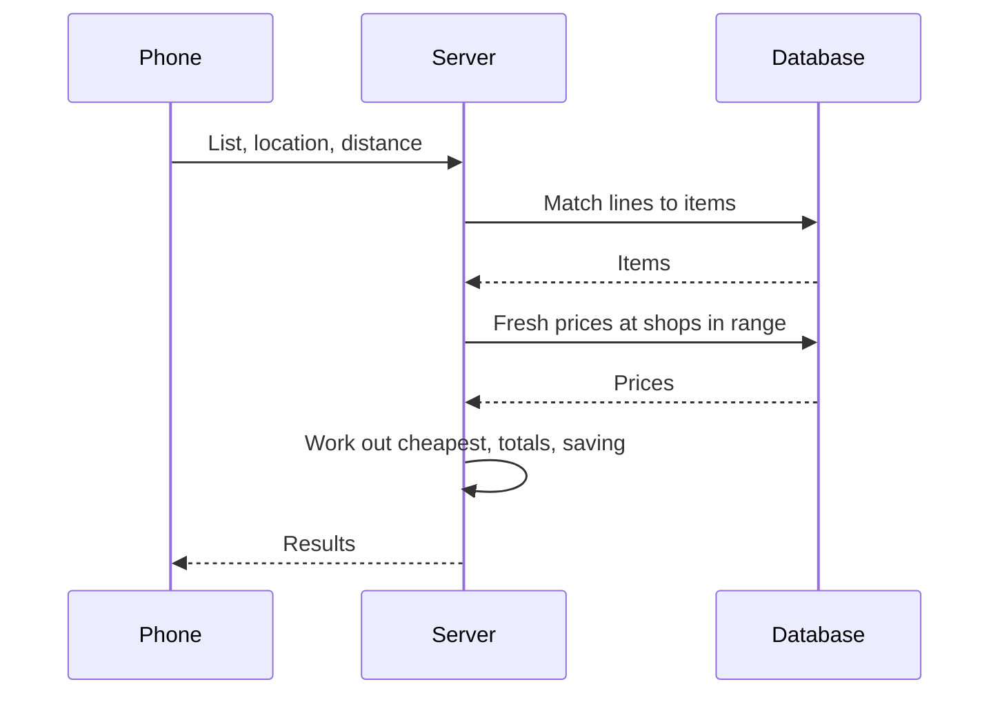
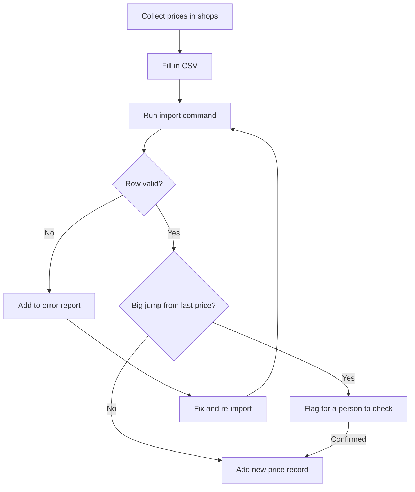
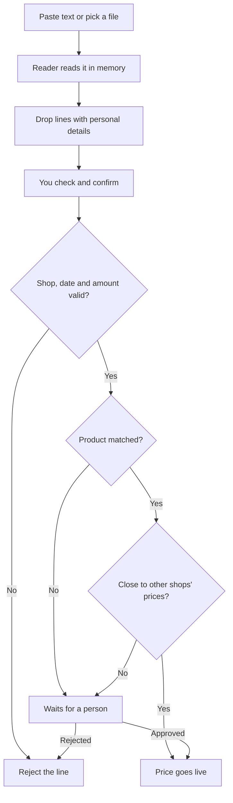

# Logical flows

All flows are Proposed, and all five are built. Flow 5 uses a stand-in reader that only understands plain text receipts.

## 1. From list to answer

This is the core of the product.

1. You open the app. Your last list loads from the device, if there is one.
2. You type items, one per line, and pick suggestions as you type.
3. You set a location and a search distance.
4. The app sends the list and the location to the server.
5. The server finds the prices (flow 3) and sends back the answer.
6. You see the cheapest place for every item, the total and the saving.
7. You switch to the shop view and go shopping.

## 2. Setting your location

1. The app asks for a postcode, or offers to use the device location.
2. If you use device location, the browser asks for permission. If you refuse, you go back to the postcode.
3. A postcode must be on the launch area list. If it isn't, the app tells you the service isn't available there yet.
4. The location stays on the device. It's sent with each comparison and isn't stored on the server.

## 3. Finding the cheapest place

For each line on the list:

1. Match the line to an item. If there's no match, mark it "not found", and log the text with no location.
2. Find shops within the search distance.
3. Find prices for that item's products at those shops. Only packs inside the item's size band count. Only the newest price for each shop and product is used, and it's dropped if it's past the freshness limit or its promotion has ended.
4. If no prices are left, mark it "no price nearby".
5. Pick the lowest price per unit of measure, such as per kg or per litre.
6. If two shops tie, pick the nearer one.

Then for the whole list:

1. Add up the per-item prices, using the quantity on each line.
2. Find the best single shop: the one that covers the most items, then the one with the lowest total.
3. Work out the saving using only items both sides cover, and say how many items that is.
4. Group the results by shop.

The server flow for one comparison:

## 4. Loading prices

1. Someone collects prices in shops and fills in the CSV template.
2. The import command checks every row: known shop, known product, sensible whole-number price, valid date that isn't in the future.
3. Rows for a shop, product and day that already exist are skipped as duplicates.
4. A price far from the last known price (50% or more) is held back in `flagged.csv`. Bad rows are listed by row number and aren't loaded.
5. Good rows are added as new price records, so history is kept. After checking flagged rows, a person imports them with `--accept-flagged`.
6. A daily check counts prices by age. It exits with an error when most prices are stale, so a timer or monitor can alert.

## 5. Sending in a price (Phase 2)

1. You paste a receipt as text or choose a file. Photos will work once a real reader is connected.
2. A reader turns it into shop, items, prices and date. The real reader would be an AI vision model. The built-in stand-in only reads plain text, and says so when given a photo.
3. Lines with card numbers, names, phone numbers or emails are dropped. The file is read in memory and never saved.
4. Each line is matched to an item and, when the size or brand makes it clear, to a product.
5. You check what was read, pick the product where it's unclear, fix prices and choose the shop.
6. Checks run on each line: known shop, a date within the last 7 days, a sensible price, and a price within 40% of what other shops charge.
7. Clear lines go live. Lines with no product, too few other prices to compare with, or a far-off price wait for a person, who runs `npm run review`.

